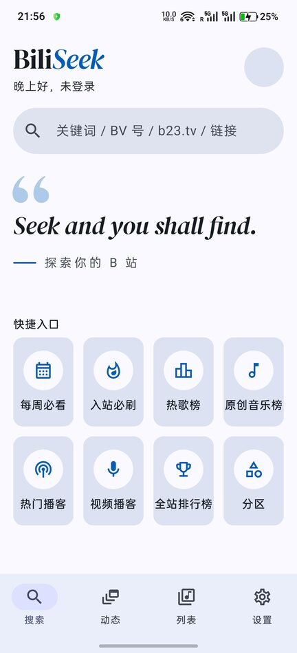
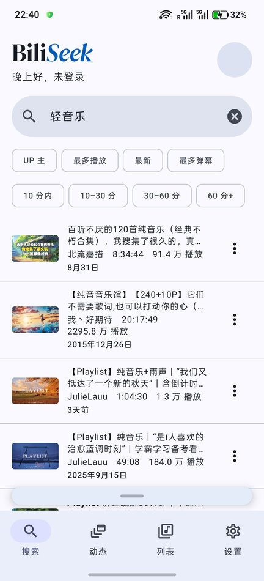

<p align="center"></p>

# BiliSeek

> **Seek and you shall find.** 寻则得之。

一个以搜索为入口、以听为主、也能随时看视频的第三方哔哩哔哩 Android 客户端，**没有推荐，没有广告**。

[](LICENSE)
[](https://github.com/wym68/BiliSeek/releases/latest)

<p align="center">
  
  
  
  
</p>

## 为什么做它

B 站的第三方客户端大致有两类：纯音频播放器干净、没有推荐，但只能听；完整客户端能看能听，但都带推荐首页，以刷视频为主。BiliSeek 想要的是两者之间的样子：

- **打开就是搜索框**：想听什么就搜什么，搜遍全站
- **默认只听**：很多内容不需要盯着屏幕，后台、锁屏照样播
- **想看再看**：一个按钮切到画面，不重新加载、不跳进度
- **没有算法推荐**：首页只有搜索、榜单、你自己的列表和关注

> **说明**：本项目的代码全部借助 AI 工具编写。个人时间和精力有限，没能逐行细致审查，发现问题欢迎提 Issue 告诉我。项目以满足个人日常使用为目标，会不定期完善；需要别的功能，欢迎 fork 后自行修改。基于本项目的二次开发须遵守 GPLv3 协议。

## 功能

**搜索与发现**
- 全站搜索视频和 UP 主，可按时长、排序筛选；多 P 视频合成一条
- 粘贴 BV 号、av 号、视频链接、b23.tv 短链都能直接识别；从其他 App 分享过来直接播放
- 首页快捷入口：每周必看、入站必刷、热歌榜、原创音乐榜、全站排行榜、热门播客、视频播客，以及 22 个子分区的新投稿；入口可以自选、排序

**听与看**
- 默认只听：后台播放，锁屏、通知栏、耳机都能控制，音量自动均衡
- 一键切到看：横过手机自动全屏，支持手势、画中画、弹幕、画质和音质选择
- 两层播放队列：自己「加入队列」的不会被下一次点播冲掉；顺序、循环、单曲、随机，倍速，定时关闭
- 底部迷你条：拖动调进度，长按出刻度尺精细定位

**列表与离线**
- 本地列表（拖动排序、自定义图标），B 站收藏夹、订阅合集、稍后再看
- 下载音频或视频，断点续传，没网也能播
- 收听时长热力图，点开看当天听了什么

**账号与互动**（扫码登录）
- 关注动态（可按 UP 主筛选）、UP 主空间、关注列表
- 点赞、投币、收藏、分享，长按点赞一键三连
- 评论区：置顶评论、热度 / 时间排序、楼中楼、草稿；发评论可以附图、插入视频截图、@ 人
- 消息中心：回复与@、收到的赞、新粉丝、私信

**AI 视频总结**
- 依次取 B 站官方总结、字幕、本机离线语音识别（音频不上传）作为原文
- 用你自己配置的 OpenAI 兼容模型生成笔记、大纲，时间戳点一下就跳过去播

## 下载安装

到 [Releases](https://github.com/wym68/BiliSeek/releases/latest) 下载最新的 `BiliSeek-x.y.z.apk` 安装即可。

- 需要 Android 8.0 及以上，**仅支持 64 位 ARM 手机**（arm64-v8a，近几年的手机基本都是）
- 同页的 `mapping.txt` 是开发者还原崩溃日志用的，不用下载
- 新版本直接覆盖安装，数据会保留

## 账号安全

- 只用网页扫码登录：不输入密码，不冒用官方 App 的身份
- 点赞、评论这类操作只在你亲手点的时候才发出
- 被 B 站风控拦截时立即停下、等一段时间再试，绝不连续重试
- AI 总结的请求不带 B 站登录信息；API Key 加密保存在本机

## 自己构建

需要 Android SDK 和 JDK 21 以上（可以直接用 Android Studio 自带的 JBR）。

```bash
git clone https://github.com/wym68/BiliSeek.git && cd BiliSeek
echo "sdk.dir=$HOME/Android/Sdk" > local.properties
./gradlew installDebug        # 构建并安装到已连接的手机
./gradlew test                # 单元测试（完全离线）
```

环境配置见 [开发环境搭建](docs/01-开发环境搭建.md)，正式版构建见 [发版清单](docs/发版清单.md)，架构与开发记录在 [`docs/`](docs/)。参与开发前请先读 [AGENTS.md](AGENTS.md)：**自动化测试绝不访问 B 站服务器**，以免账号被风控。

## 授权

本项目采用 [GPLv3](LICENSE)。实现上参考了 BiliPai（GPLv3），派生作品须同为 GPLv3。第三方项目的致谢与授权说明见 [NOTICE](NOTICE)。

> 参考项目 [biu](https://github.com/wood3n/biu) 采用 PolyForm Noncommercial 1.0.0，不是开源许可证，与 GPLv3 不兼容。本项目只参考了它的产品设计和公开接口用法，没有使用其任何代码或资源。

## 免责声明

- 本项目是**非官方**第三方客户端，与哔哩哔哩没有任何关联，也未获其认可
- 数据来自哔哩哔哩公开接口，仅供学习研究，不用于商业用途
- 使用时请遵守哔哩哔哩用户协议和相关法律法规
- 因使用本项目造成的账号异常或其他后果，由使用者自行承担
